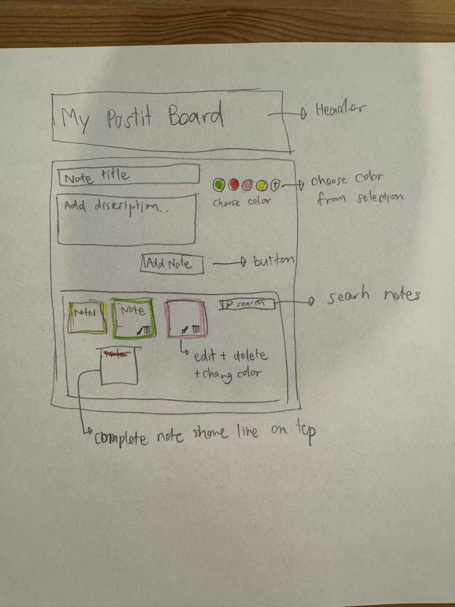
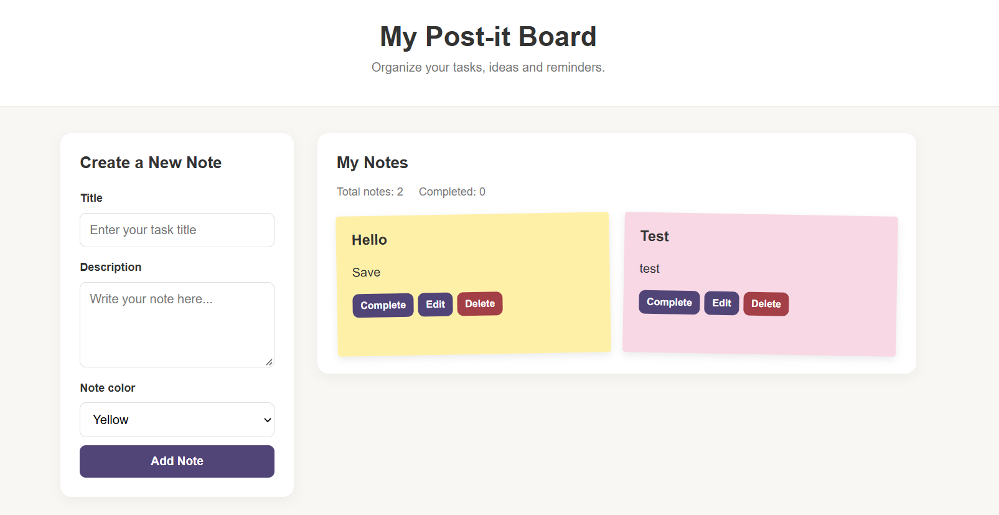

# My Post-it Board

**Author(s):** Kalyakorn Worachat

## Project plan

### Project idea

My Post-it Board is a simple web application that helps users organize their daily tasks, reminders, and ideas using colorful sticky notes. It is intended for students and anyone who wants to manage tasks in one place.

### Planned features

- Add notes with a title and description.
- Choose different colors for notes.
- Mark tasks as completed and undo completion.
- Edit and delete notes.
- Save notes in the browser using localStorage.

### Wireframe / sketch

## Web links

- **Published application:** https://kalyakornw.github.io/web-development-1/PostItBoard/?utm_source=chatgpt.com
- **GitHub repository:** https://github.com/kalyakornw/web-development-1
- **Project video presentation:** https://teams.microsoft.com/l/meetingrecap?driveId=b%218SqQKMUAiUaLx0xHs5_1fP4NKVlXBD5AhJ_4SgQ9xcHu9Ff0VPsqRrcxYQt-yl_N&driveItemId=01CR6EHEJQUCSCA2WFKBAJGSSM3RRRI5HD&sitePath=https%3A%2F%2Flaureauas-my.sharepoint.com%2Fpersonal%2Fkaw00022_laurea_fi%2FDocuments%2FTallenteet%2FMeeting+with+Kalyakorn+Worachat-20261027_184349-Meeting+Recording.mp4&fileUrl=https%3A%2F%2Flaureauas-my.sharepoint.com%2Fpersonal%2Fkaw00022_laurea_fi%2FDocuments%2FTallenteet%2FMeeting+with+Kalyakorn+Worachat-20261027_184349-Meeting+Recording.mp4&threadId=19%3Ameeting_NzRhMzlkZjUtYjYwZC00NzE1LTgwZGUtNGFlMjVkNDEwNzFi%40thread.v2&organizerId=ee46521e-9e7f-4404-9731-f39350f6a07d&tenantId=f0b9e9d7-8d66-4b16-9c1c-6b07c4796280&callId=d3461067-8d52-4720-8b51-88b9e8799899&threadType=Meeting&meetingType=MeetNow&subType=RecapSharingLink_RecapCore&recapType=RecordingAndTranscript

## About the application

**My Post-it Board** is a browser-based application for organizing tasks and reminders. Users can create colorful notes, edit or delete them, and mark tasks as completed. The application uses localStorage to save notes in the browser, so they remain available after refreshing the page.

## Technologies

- HTML – page structure and form.
- CSS – styling, layout, and responsive design.
- JavaScript – application functionality and event handling.
- DOM scripting – creating and updating notes on the page.
- localStorage – saving notes in the browser.

## How to use the application

1. Open the application in a browser.
2. Enter a title and description.
3. Choose a note color and click Add Note.
4. Use Complete, Undo, Edit, or Delete to manage notes.
5. Refresh the page to check that notes remain saved.

## Running the application locally

1. Clone or download the repository.
2. Open the PostItBoard folder.
3. Open index.html in a web browser.

## Screenshots

## Known issues / limitations

Notes are saved in the browser where they were created. They are not automatically synchronized between devices.

## Self-assessment and learning reflection

- **What did I succeed in?** I created a working application that can add, edit, delete, and complete notes.
- **What was challenging?** To be completed after further testing. To choose which code should äi use for each section . What shoudl start to coding first in structure order. 
- **What would I improve if I had more time?** I would consider adding note search and filtering and make the style looking better.
- **What did I learn?** I practised HTML forms, CSS layouts, JavaScript events, DOM manipulation, and localStorage.
- **What remained unclear?** Some coding i dont completely understand why but i guess it just have to be like that .
- **My self-assessed project grade:** I think I would give my self a pretty decent point in petient to build this project. 

## Sources and acknowledgements

- AI tool used: ChatGPT.
  - How the tool was used: To help plan the application, explain code concepts, troubleshoot issues, and prepare documentation. The author tests and reviews the code to understand how it works.

